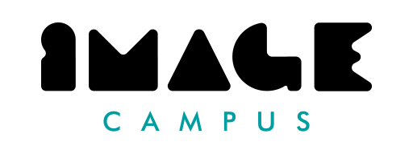

# The Door

The Door es un plataformero 2D de desplazamiento lateral en el que deberás explorar el escenario, enfrentarte a enemigos y alcanzar la salida.

Con mecánicas de movimiento, combate y exploración, The Door ofrece una experiencia breve que pone a prueba tus reflejos y habilidades.

Este juego fue desarrollado por un estudiante de <a href="https://www.imagecampus.edu.ar/">Image Campus</a>.

  

## Controles

Joystick:
- A: saltar
- X: disparar
- Analógico: movimiento
- Botón pausa: pausa

Teclado & Mouse:
- Barra espaciadora: saltar
- Click izquierdo: disparar
- WASD: movimiento
- P: pausa

## Créditos

- **Nicolás Mironoff** - *Programación*
- **VEXED** - *Arte (Asset Pack)*
- **Música y SFX** - *Pixabay*

Este juego también fue posible gracias al acompañamiento del profesor:

- **Federico Olive**

## Tecnologías utilizadas

- Unity
- C#

## Características de programación

- Arquitectura basada en componentes
- Diseño basado en datos mediante ScriptableObjects
- Arquitectura orientada a eventos
- Máquinas de estados finitos (FSM) para el jugador y los enemigos
- Inteligencia artificial de enemigos basada en estados
- Sistema de combate y salud
- Sistema de checkpoints y respawn
- Sistema de loot y objetos coleccionables
- Sistema de audio mediante AudioMixer
- Patrón Command
- Composición sobre herencia

itch.io: [https://nicomironoff.itch.io/the-door
](https://nicomironoff.itch.io/the-door)
